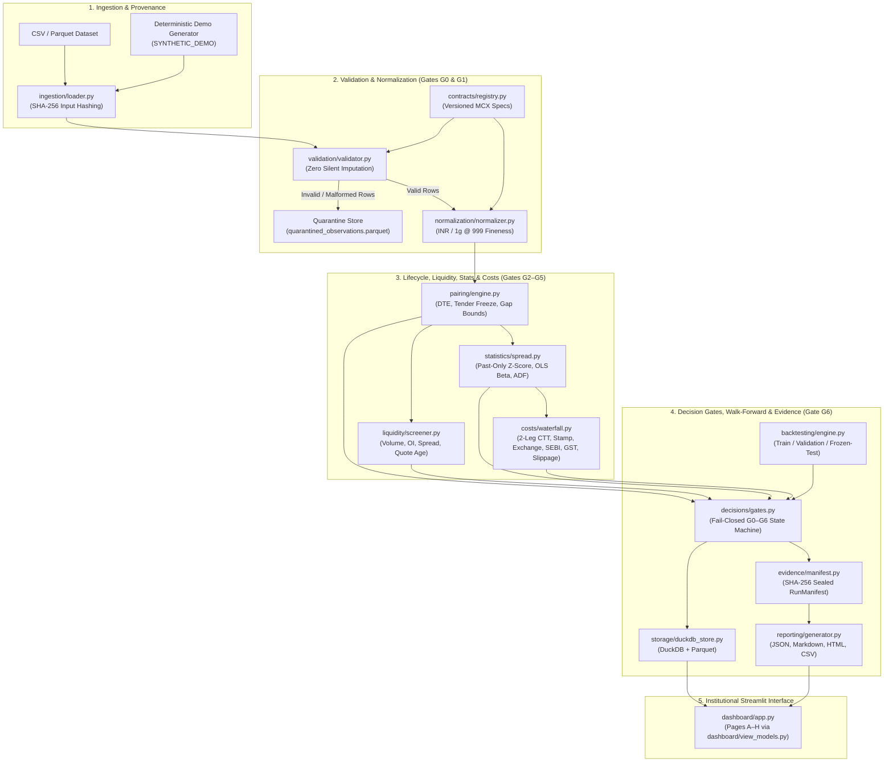
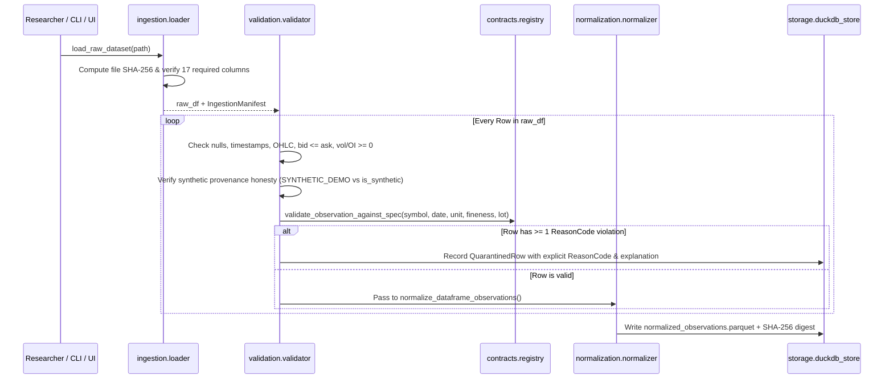
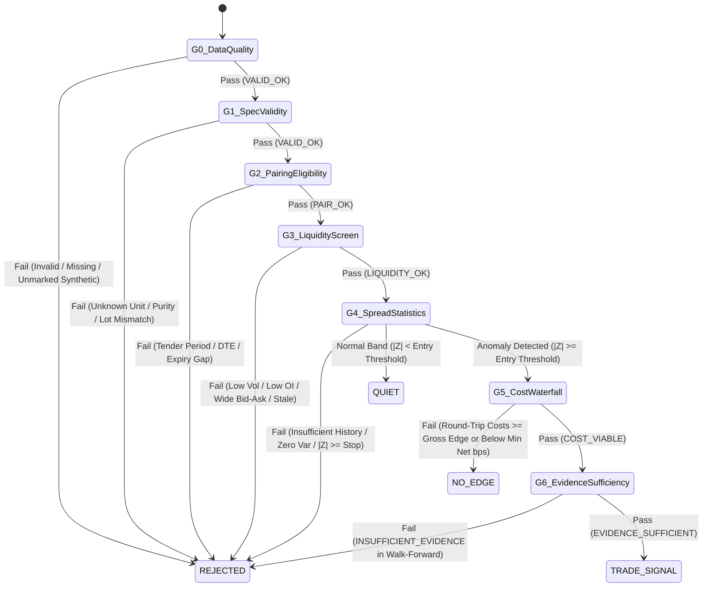

# AUREUS-RV 3.0

**Lifecycle-Aware MCX Gold Futures Relative-Value Research Instrument**  
*Developed by **Global Focus Innovators***

[](https://www.python.org/)
[](https://duckdb.org/)
[](https://streamlit.io/)
[](#9-automated-testing--verification)
[](LICENSE)

> **Core Engineering Principle:** `NORMALIZE → VALIDATE → PAIR → COST → ABSTAIN → PROVE`

**AUREUS-RV 3.0** is an institutional-grade, fail-closed quantitative research and validation engine for relative-value (calendar and cross-variant spread) opportunities across Indian Multi Commodity Exchange (MCX) gold futures (`GOLD`, `GOLDM`, `GOLDPETAL`, `GOLDGUINEA`).

Unlike naive spread trackers that compare raw unadjusted prices or ignore transaction costs, AUREUS-RV 3.0 enforces:
1. **Zero-Imputation Data Quarantine (Gate G0):** Rejects missing fields, inverted bid-ask quotes, OHLC inconsistencies, duplicates, and unmarked synthetic rows with explicit machine-readable `ReasonCode` audit trails.
2. **Physical Purity & Unit Normalization (Gate G1):** Normalizes all comparable gold quotations to **INR per 1 gram at 999 fineness** while keeping contract lot sizes (`1,000g`, `100g`, `8g`, `1g`) and multipliers strictly separate.
3. **Expiry-Aware Pairing & Tender-Period Freeze (Gate G2):** Enforces minimum/maximum calendar expiry distance limits and automatically freezes near-month legs prior to physical delivery tender windows.
4. **Historical Liquidity Screening (Gate G3):** Screens volume, open interest, bid-ask spread (bps), quote freshness, and rolling bar counts using strictly historical data available at the decision timestamp.
5. **Leakage-Free Statistical Spread Diagnostics (Gate G4):** Computes strictly past-only ($\le T$) normalized spreads, rolling means, volatilities, z-scores, OLS regressions ($\alpha, \beta, R^2$), standardized residuals, and optional Augmented Dickey-Fuller (ADF) stationarity diagnostics.
6. **Two-Leg Indian Derivatives Transaction-Cost Waterfall (Gate G5):** Accounts for 4 leg executions per round-trip across **Base**, **Conservative**, and **Stress** scenarios (Brokerage, MCX Exchange charge, SEBI turnover fee, 18% GST on applicable services, sell-side-only CTT, buy-side-only Stamp Duty, bid-ask spread crossing, and execution slippage).
7. **Chronological Walk-Forward Backtesting & Evidence Sufficiency (Gate G6):** Partitioned into chronological `TRAIN` / `VALIDATION` / `FROZEN_TEST` splits with non-overlapping trade controls, naive baseline comparison, and automatic fail-closed abstention (`INSUFFICIENT_EVIDENCE`) when sample requirements are unmet.
8. **Cryptographically Sealed Evidence & Institutional Dashboard:** Persists runs, decisions, and backtests to **DuckDB** and **Parquet**, seals outputs in a **SHA-256 `run_manifest.json`**, and exposes an 8-page dark-charcoal & gold **Streamlit** research workbench.

> **Governance & Research Disclaimer:** A `TRADE SIGNAL` emitted by AUREUS-RV 3.0 is a quantitative research classification only—not an automated execution order, brokerage recommendation, or guarantee of profitability. Built-in synthetic demonstration datasets are explicitly labeled (`SYNTHETIC_DEMO`) and are never conflated with verified live MCX exchange feeds.

---

## Table of Contents

1. [System Architecture & Diagrams](#1-system-architecture--diagrams)
2. [System Design & Module Responsibilities](#2-system-design--module-responsibilities)
3. [Quantitative Methodology & Normalization Math](#3-quantitative-methodology--normalization-math)
4. [Two-Leg Indian Transaction-Cost Waterfall Model](#4-two-leg-indian-transaction-cost-waterfall-model)
5. [Deterministic Decision Engine (Gates G0–G6)](#5-deterministic-decision-engine-gates-g0g6)
6. [Chronological Backtesting & Walk-Forward Validation](#6-chronological-backtesting--walk-forward-validation)
7. [Data Dictionary & DuckDB Schema](#7-data-dictionary--duckdb-schema)
8. [Institutional Streamlit Dashboard (Pages A–H)](#8-institutional-streamlit-dashboard-pages-ah)
9. [Quick Start, CLI Workflow & Single-Command Launch](#9-quick-start-cli-workflow--single-command-launch)
10. [Five-Minute Reproducible Judge Walkthrough](#10-five-minute-reproducible-judge-walkthrough)
11. [Repository Structure & Documentation Suite](#11-repository-structure--documentation-suite)
12. [Known Limitations & Honest Scope](#12-known-limitations--honest-scope)

---

## 1. System Architecture & Diagrams

### 1.1 End-to-End System Architecture



### 1.2 Data Ingestion & Quarantine Sequence



### 1.3 Deterministic Decision Gate State Machine (G0–G6)



---

## 2. System Design & Module Responsibilities

| Module | File Path | Core Responsibilities |
| :--- | :--- | :--- |
| **Domain Models & Reason Codes** | `src/aureus_rv/models.py` | Immutable `ContractInstanceId`, `PairId`, `DecisionState`, `SpreadDirection`, `CostScenarioName`, `ReasonCode` (36 explicit reason codes), `GateEvaluation`, `DecisionRecord`, `QuarantinedRow`, and structured `AureusError`. |
| **Configuration & Hashing** | `src/aureus_rv/config/settings.py` | Validated Pydantic v2 configuration models (`AureusConfig`, `PairingConfig`, `LiquidityConfig`, `StatisticsConfig`, `CostsConfig`, `BacktestConfig`), YAML serialization, and canonical SHA-256 config hashing. |
| **Contract Registry** | `src/aureus_rv/contracts/registry.py` | Effective-dated specification registry (`ContractRegistry`, `ContractSpec`) for `GOLD`, `GOLDM`, `GOLDPETAL`, and `GOLDGUINEA`, including quotation units, purity fineness, lot sizes, multipliers, and tender-period rules. |
| **Ingestion Loader** | `src/aureus_rv/ingestion/loader.py` | CSV and Parquet ingestion, schema column verification, and SHA-256 file digest computation (`IngestionManifest`). |
| **Data-Quality Validator** | `src/aureus_rv/validation/validator.py` | Row-by-row validation without silent imputation; quarantines invalid prices, inverted quotes, duplicates, dishonest provenance flags, and spec mismatches. |
| **Price Normalizer** | `src/aureus_rv/normalization/normalizer.py` | Converts raw gold quotations to **INR per 1g at 999 fineness** while maintaining strict separation from contract lot size and notional value. |
| **Expiry-Aware Pairing** | `src/aureus_rv/pairing/engine.py` | Evaluates DTE, calendar expiry gap bounds, and near-leg tender/rollover freezes; aligns two-leg histories strictly up to $t \le T$ (`align_pair_history_up_to`). |
| **Liquidity Screener** | `src/aureus_rv/liquidity/screener.py` | Screens trailing observation counts, traded volume, open interest, bid-ask spread (bps), and quote staleness (`PROXY_BAR_VOLUME_OI_BIDASK`). |
| **Statistical Research Engine** | `src/aureus_rv/statistics/spread.py` | Computes past-only normalized spreads, percentage/bps spreads, rolling mean/std, z-scores, OLS regressions ($\alpha, \beta, R^2$), standardized residuals, correlation, and optional ADF stationarity tests. |
| **Transaction-Cost Engine** | `src/aureus_rv/costs/waterfall.py` | Computes exact two-leg round-trip cost waterfalls across `base`, `conservative`, and `stress` scenarios, gross vs. net convergence, breakeven bps, and scenario sensitivity. |
| **Decision Gate Engine** | `src/aureus_rv/decisions/gates.py` | Evaluates Gates `G0`–`G6` with fail-closed semantics and emits auditable `DecisionRecord` instances (`QUIET`, `REJECTED`, `NO-EDGE`, `TRADE SIGNAL`). |
| **Walk-Forward Backtester** | `src/aureus_rv/backtesting/engine.py` | Executes chronological `TRAIN` / `VALIDATION` / `FROZEN_TEST` walk-forward evaluation with non-overlapping position limits, rollover forced exits, naive hold baselines, and `INSUFFICIENT_EVIDENCE` detection. |
| **Evidence & Manifests** | `src/aureus_rv/evidence/manifest.py` | Generates self-sealing SHA-256 `RunManifest` files and verifies post-run artifact integrity on disk (`verify_run_manifest`). |
| **DuckDB & Parquet Storage** | `src/aureus_rv/storage/duckdb_store.py` | Persists `research_runs`, `decisions`, `backtest_summaries`, and `quarantined_rows` in DuckDB and time-series artifacts in Parquet. |
| **Report Generator** | `src/aureus_rv/reporting/generator.py` | Generates `research_report.json`, `research_report.md`, standalone `research_report.html`, and `decisions_export.csv`. |
| **Streamlit Dashboard** | `src/aureus_rv/dashboard/` | 8-page dark-charcoal & gold institutional interface (`app.py`, `view_models.py`, `theme.py`) backed 100% by real engine outputs. |

---

## 3. Quantitative Methodology & Normalization Math

### 3.1 Versioned MCX Gold Contract Specifications

| Symbol | Variant Description | Quotation Unit | Quoted Grams ($g_i$) | Purity Fineness | Lot Size (Grams) | Lot Price Multiplier | Tender Period |
| :--- | :--- | :--- | ---: | ---: | ---: | ---: | ---: |
| `GOLD` | MCX Standard Gold (1 kg) | `INR_PER_10G` | `10.0 g` | `995` | `1,000.0 g` | `100.0x` | `5 days` |
| `GOLDM` | MCX Gold Mini (100 g) | `INR_PER_10G` | `10.0 g` | `999` | `100.0 g` | `10.0x` | `5 days` |
| `GOLDGUINEA` | MCX Gold Guinea (8 g) | `INR_PER_8G` | `8.0 g` | `999` | `8.0 g` | `1.0x` | `5 days` |
| `GOLDPETAL` | MCX Gold Petal (1 g) | `INR_PER_1G` | `1.0 g` | `999` | `1.0 g` | `1.0x` | `5 days` |

### 3.2 Physical Normalization Formula

All valid observations are converted to **INR per 1 gram at 999 fineness**:

$$\text{Normalized INR/g (999)} = P^{\text{raw}}_{i,t} \times \left(\frac{999}{\text{purity\_fineness}_i}\right) \times \frac{1}{\text{quotation\_grams}_i}$$

For an input quoted in **INR per 10 grams at 995 fineness** (`GOLD`):

$$\text{Normalized INR/g (999)} = \text{Quoted INR per 10 g} \times \left(\frac{999}{995}\right) \Big/ 10$$

Contract lot notional is kept strictly separate from normalized unit price:

$$\text{Contract Lot Notional (INR)} = P^{\text{raw}}_{i,t} \times \left(\frac{\text{lot\_size\_grams}_i}{\text{quotation\_grams}_i}\right)$$

---

## 4. Two-Leg Indian Transaction-Cost Waterfall Model

Every spread trade requires **4 executions** across a complete round-trip: Entry + Exit on Near Leg $A$ (1 Buy + 1 Sell) and Entry + Exit on Far Leg $B$ (1 Buy + 1 Sell).

For each leg with normalized price $P$ (INR/g @ 999) and bid-ask spread $s_{\text{ba}}$ (bps):
- **Brokerage (2 executions):** $C_{\text{brok}} = 2 \cdot P \cdot (r_{\text{brok, bps}} \times 10^{-4})$
- **MCX Exchange Transaction Fee (2 executions):** $C_{\text{exch}} = 2 \cdot P \cdot (r_{\text{exch, bps}} \times 10^{-4})$
- **SEBI Turnover Fee (2 executions):** $C_{\text{sebi}} = 2 \cdot P \cdot (r_{\text{sebi, bps}} \times 10^{-4})$
- **GST (18% on Brokerage + Exchange + SEBI only):** $C_{\text{gst}} = 0.18 \times (C_{\text{brok}} + C_{\text{exch}} + C_{\text{sebi}})$
- **CTT — Commodity Transaction Tax (1 Sell execution ONLY):** $C_{\text{ctt}} = 1 \cdot P \cdot (r_{\text{ctt, bps}} \times 10^{-4})$ (`0.01% = 1.00 bps`)
- **Stamp Duty (1 Buy execution ONLY):** $C_{\text{stamp}} = 1 \cdot P \cdot (r_{\text{stamp, bps}} \times 10^{-4})$ (`0.002% = 0.20 bps`)
- **Bid-Ask Spread Crossing:** $C_{\text{spread}} = P \cdot (s_{\text{ba}} \times 10^{-4}) \cdot m_{\text{spread}}$
- **Execution Slippage (2 executions):** $C_{\text{slip}} = 2 \cdot P \cdot (r_{\text{slip, bps}} \times 10^{-4})$

| Cost Component | Base (`base`) | Conservative (`conservative`) | Stress (`stress`) |
| :--- | ---: | ---: | ---: |
| **Brokerage (per execution)** | `0.30 bps` | `0.60 bps` | `1.00 bps` |
| **MCX Exchange Fee (per execution)** | `0.26 bps` | `0.26 bps` | `0.26 bps` |
| **SEBI Fee (per execution)** | `0.01 bps` | `0.01 bps` | `0.01 bps` |
| **GST (on Brokerage + Exchange + SEBI)** | `18.0%` | `18.0%` | `18.0%` |
| **CTT (Sell execution only)** | `1.00 bps` | `1.00 bps` | `1.00 bps` |
| **Stamp Duty (Buy execution only)** | `0.20 bps` | `0.20 bps` | `0.20 bps` |
| **Execution Slippage (per execution)** | `0.50 bps` | `1.00 bps` | `2.00 bps` |
| **Half-Spread Multiplier** | `1.00x` | `1.25x` | `1.75x` |

---

## 5. Deterministic Decision Engine (Gates G0–G6)

| Gate | Gate Name | Verification Criteria | Failure State & Reason Codes |
| :--- | :--- | :--- | :--- |
| **G0** | **Data Quality Validation** | Non-null schema, valid timestamps, positive prices, `bid <= ask`, OHLC consistency, non-negative vol/OI, honest provenance. | `REJECTED` (`ERR_NON_POSITIVE_PRICE`, `ERR_BID_ASK_INVERTED`, `ERR_DUPLICATE_OBSERVATION`, `ERR_UNMARKED_SYNTHETIC_SOURCE`) |
| **G1** | **Specification & Normalization** | Symbol exists in `ContractRegistry` on observation date; unit, fineness, and lot size match effective spec. | `REJECTED` (`ERR_UNKNOWN_CONTRACT_SYMBOL`, `ERR_UNKNOWN_QUOTATION_UNIT`, `ERR_SPEC_PURITY_MISMATCH`) |
| **G2** | **Pairing & Expiry Eligibility** | `dte_near >= max(min_dte, tender_period_days)` and `min_gap <= expiry_gap_days <= max_gap`. | `REJECTED` (`ERR_NEAR_LEG_IN_TENDER_OR_ROLLOVER`, `ERR_EXPIRY_DISTANCE_TOO_LARGE`, `ERR_EXPIRY_DISTANCE_TOO_SMALL`) |
| **G3** | **Historical Liquidity Screening** | Trailing bars $\ge W_{\min}$, volume $\ge \text{vol}_{\min}$, OI $\ge \text{OI}_{\min}$, bid-ask spread $\le s_{\max}$, quote age $\le a_{\max}$. | `REJECTED` (`ERR_LOW_VOLUME`, `ERR_LOW_OPEN_INTEREST`, `ERR_WIDE_BID_ASK_SPREAD`, `ERR_INSUFFICIENT_OBSERVATION_COUNT`) |
| **G4** | **Statistical Spread Diagnostics** | Non-zero spread variance, stable OLS $\beta \in [0.2, 5.0]$, correlation $\ge \rho_{\min}$, $|Z| < Z_{\text{stop}}$. If $|Z| < Z_{\text{entry}} \rightarrow$ normal band. | `REJECTED` on invalid stats/stop; **`QUIET`** (`STATS_WITHIN_NORMAL_BAND`) when $|Z| < Z_{\text{entry}}$ |
| **G5** | **Transaction-Cost Viability** | Expected gross convergence exceeds two-leg round-trip costs by at least `min_net_edge_bps` (`1.5 bps`) and `min_gross_to_cost_ratio` (`1.25x`). | **`NO-EDGE`** (`NO_EDGE_COSTS_EXCEED_SPREAD`, `NO_EDGE_BELOW_MIN_NET_BPS`, `NO_EDGE_INSUFFICIENT_NET_RATIO`) |
| **G6** | **Research Evidence Sufficiency** | Walk-forward evaluation meets `min_completed_trades_for_evidence` and `min_bars_for_backtest`. | `REJECTED` (`INSUFFICIENT_EVIDENCE`) if unmet; **`TRADE SIGNAL`** (`STATS_ANOMALY_DETECTED`) when all G0–G6 pass |

---

## 6. Chronological Backtesting & Walk-Forward Validation

- **Chronological Partitioning:** Aligned pair histories are split chronologically into `TRAIN` (default `50%`), `VALIDATION` (`25%`), and `FROZEN_TEST` (`25%`). Model parameters are never tuned on `FROZEN_TEST`.
- **Strict Leakage Prevention:** Every historical bar $t$ is evaluated solely on observations $\le t$.
- **Position Controls & Rollover Guard:** Enforces `max_concurrent_trades_per_pair = 1`, `max_holding_bars = 15`, mean-reversion exit (`|Z| <= exit_z_threshold`), structural stop loss (`|Z| >= stop_z_threshold`), and automatic forced exit if the near leg enters the tender/rollover freeze window.
- **Naive Carry Baseline Comparison:** Reports out-of-sample net P&L alongside a naive unconditional short-spread hold baseline after full two-leg transaction costs.

---

## 7. Data Dictionary & DuckDB Schema

### 7.1 Required Input Columns (`CSV` / `Parquet`)
`timestamp`, `symbol`, `expiry_date`, `open`, `high`, `low`, `close`, `bid`, `ask`, `volume_lots`, `open_interest_lots`, `quotation_unit`, `purity_fineness`, `lot_size_grams`, `quote_age_seconds`, `source_provenance`, `is_synthetic`.

### 7.2 DuckDB Tables (`aureus_rv.duckdb`)
- `research_runs`: Run metadata, `dataset_sha256`, `config_sha256`, row/decision counts, and `manifest_self_sha256`.
- `decisions`: Every emitted `DecisionRecord` (`decision_id`, `run_id`, `pair_id`, `state`, `direction`, `primary_reason_code`, `z_score`, `spread_bps`, `net_expected_bps`, `decision_json`).
- `backtest_summaries`: Walk-forward summaries per `(run_id, pair_id, cost_scenario)` (`evidence_status`, `total_completed_trades`, `gross_pnl_inr`, `total_costs_inr`, `net_pnl_inr`, `max_drawdown_inr`, `baseline_naive_net_pnl_inr`, `report_json`).
- `quarantined_rows`: Every quarantined row (`run_id`, `row_index`, `reason_codes`, `explanation`, `raw_payload_json`).

---

## 8. Institutional Streamlit Dashboard (Pages A–H)

| Page | Title | Key Capabilities |
| :--- | :--- | :--- |
| **Page A** | **Executive Overview** | Run status, provenance badges (`SYNTHETIC_DEMO` vs verified), valid/quarantined counts, state distribution chart, and SHA-256 manifest status. |
| **Page B** | **Contract Explorer** | Versioned MCX specification registry, interactive symbol/purity/eligibility filters, raw vs. normalized (`INR/g @ 999`) table, and term-structure chart. |
| **Page C** | **Spread Research** | Interactive Near/Far contract selector, lookback and entry $|Z|$ sliders, ADF stationarity toggle, normalized price & spread charts, and rolling z-score trajectory. |
| **Page D** | **Transaction-Cost Lab** | Live controls for brokerage, MCX fee, CTT, stamp duty, slippage, and half-spread multiplier across `base`, `conservative`, and `stress` presets. |
| **Page E** | **Backtesting Workbench** | Configurable `TRAIN` / `VALIDATION` / `FROZEN_TEST` splits, minimum trade evidence slider (demonstrating live `INSUFFICIENT_EVIDENCE` abstention), and trade ledger. |
| **Page F** | **Decision Audit** | Gate-by-gate (`G0`–`G6`) pass/fail waterfall table and full JSON payload inspector for any evaluated pair. |
| **Page G** | **Data Management** | Safe CSV/Parquet file uploader (25 MB limit, extension whitelist, schema/row validation), quarantined-row CSV download, and import history. |
| **Page H** | **Reports & Evidence** | Live SHA-256 manifest verification and one-click downloads for `run_manifest.json`, `research_report.json`, `decisions.csv`, `validation_report.json`, `.md`, and `.html`. |

---

## 9. Quick Start, CLI Workflow & Single-Command Launch

```bash
# 1. Install dependencies (Python 3.11+ with uv)
uv sync --python 3.11

# 2. Run Ruff linter & 27-test Pytest suite
uv run ruff check src tests scripts
uv run pytest -v

# 3. Generate deterministic synthetic demo dataset (CSV + Parquet)
uv run python scripts/generate_demo_data.py --output-dir artifacts/demo_data

# 4. Validate dataset & print Gate G0/G1 quarantine summary
uv run python scripts/validate_dataset.py --input artifacts/demo_data/synthetic_mcx_gold.parquet

# 5. Execute full research pipeline, DuckDB persistence & SHA-256 manifest verification
uv run python scripts/run_research.py --input artifacts/demo_data/synthetic_mcx_gold.parquet --output-dir artifacts/research_run

# 6. Launch the Institutional Streamlit Research Instrument
uv run streamlit run scripts/launch_dashboard.py
```

---

## 10. Five-Minute Reproducible Judge Walkthrough

1. **Provenance & Quarantine (Page A & Page G):** Inspect the `SYNTHETIC DEMO DATASET` badge (`344` valid rows, `5` quarantined rows with explicit reason codes: `ERR_NON_POSITIVE_PRICE`, `ERR_BID_ASK_INVERTED`, `ERR_UNKNOWN_QUOTATION_UNIT`, `ERR_UNMARKED_SYNTHETIC_SOURCE`, `ERR_DUPLICATE_OBSERVATION`).
2. **Purity & Weight Normalization (Page B):** Compare `GOLD` (`INR_PER_10G` @ `995` fineness, `1,000g` lot) vs. `GOLDM` (`999` fineness, `100g` lot), `GOLDGUINEA` (`8g`), and `GOLDPETAL` (`1g`) normalized to **INR/g @ 999**.
3. **Spread Diagnostics (Page C):** Select `GOLD_2026-08-05` vs `GOLD_2026-10-05` (`DTE: 65/126`, `Z = +4.24σ`) and toggle the ADF stationarity check.
4. **Costs Erasing Apparent Edge $\rightarrow$ `NO-EDGE` (Page D):** Select `GOLD_2026-08-05__VS__GOLDM_2026-08-28` (`Z = +3.75σ`, gross edge `2.09 bps` < round-trip cost `9.58 bps` = `-7.50 bps` net) to see automatic `NO-EDGE` classification.
5. **Chronological Validation & `INSUFFICIENT_EVIDENCE` (Page E):** Inspect the `TRAIN` / `VALIDATION` / `FROZEN_TEST` split results, then raise **Min Completed Trades for Evidence (G6)** from `3` to `6` to watch Gate G6 fail closed to `INSUFFICIENT_EVIDENCE`.
6. **Gate Audit & Cryptographic Manifest Export (Page F & Page H):** Inspect the `G0`–`G6` waterfall for any `REJECTED`, `NO-EDGE`, `QUIET`, or `TRADE SIGNAL` record and download the SHA-256 verified reports.

---

## 11. Repository Structure & Documentation Suite

Full technical documentation is located in [`docs/`](docs/):
- [`docs/SYSTEM_ARCHITECTURE.md`](docs/SYSTEM_ARCHITECTURE.md) — End-to-end architecture, ingestion sequence, and G0–G6 state machine diagrams.
- [`docs/SYSTEM_DESIGN.md`](docs/SYSTEM_DESIGN.md) — Design principles and module responsibility matrix.
- [`docs/DATA_DICTIONARY.md`](docs/DATA_DICTIONARY.md) — Input schema, derived normalized columns, and DuckDB tables.
- [`docs/QUANTITATIVE_METHODOLOGY.md`](docs/QUANTITATIVE_METHODOLOGY.md) — Physical normalization equations, pairing rules, and rolling statistical diagnostics.
- [`docs/TRANSACTION_COST_MODEL.md`](docs/TRANSACTION_COST_MODEL.md) — Two-leg Indian derivatives round-trip cost equations and scenario tables.
- [`docs/BACKTESTING_AND_VALIDATION.md`](docs/BACKTESTING_AND_VALIDATION.md) — Chronological splits, leakage prevention proof, and exit triggers.
- [`docs/SECURITY.md`](docs/SECURITY.md) — Safe upload validation and SHA-256 manifest scope.
- [`docs/API_AND_MODULE_REFERENCE.md`](docs/API_AND_MODULE_REFERENCE.md) — CLI and Python public function signatures.
- [`docs/DEMO_GUIDE.md`](docs/DEMO_GUIDE.md) — 10-step reproducible demonstration script.
- [`docs/LIMITATIONS.md`](docs/LIMITATIONS.md) — Honest limitations and future work.
- [`docs/JUDGE_WALKTHROUGH.md`](docs/JUDGE_WALKTHROUGH.md) — Judge verification checklist and technical Q&A.

---

## 12. Known Limitations & Honest Scope

- **Synthetic Demo Default:** The repository ships with a deterministic synthetic dataset (`SYNTHETIC_DEMO`) to enable offline reproducibility without paid exchange data subscriptions. The system has not been independently validated on live tick-by-tick MCX order-book feeds.
- **Proxy Liquidity Measures:** Liquidity screening uses bar-level volume, open interest, top-of-book bid-ask spread, and quote age (`PROXY_BAR_VOLUME_OI_BIDASK`), not full L2/L3 order-book depth.
- **Hash Scope:** SHA-256 digests in `run_manifest.json` verify computational reproducibility and post-run artifact immutability; they do not prove the external authenticity of an uploaded dataset.
