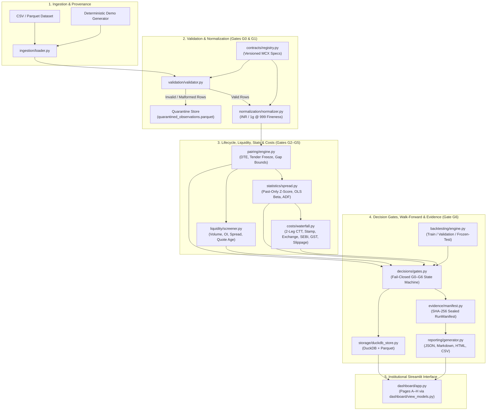
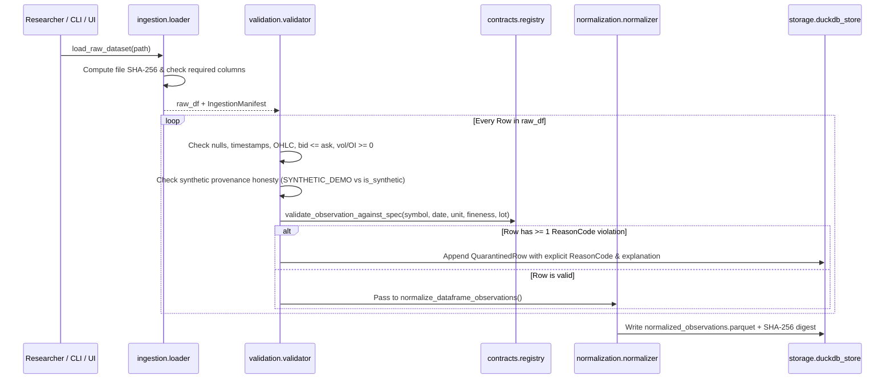
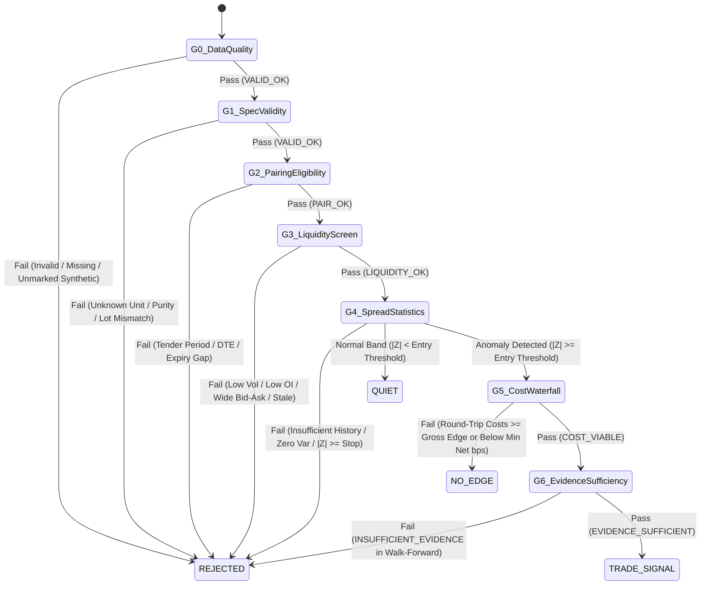

# AUREUS-RV 3.0 — System Architecture

> **Core Engineering Principle:** `NORMALIZE → VALIDATE → PAIR → COST → ABSTAIN → PROVE`

## 1. Architectural Overview

**AUREUS-RV 3.0** is a deterministic, fail-closed quantitative research and decision-support instrument for relative-value opportunities across Indian MCX gold futures variants (`GOLD`, `GOLDM`, `GOLDPETAL`, `GOLDGUINEA`). It separates raw ingestion, data-quality quarantine, physical unit/purity normalization, expiry-aware pairing, liquidity screening, rolling past-only statistical diagnostics, two-leg Indian commodity derivatives transaction-cost waterfalls, G0–G6 decision gates, walk-forward backtesting, and SHA-256 verifiable DuckDB/Parquet evidence storage.

## 2. End-to-End Architecture Diagram

## 3. Data Ingestion & Quarantine Flow

## 4. Decision Gate State Machine (G0–G6)

## 5. Research-Run Lifecycle

```mermaid
flowchart LR
    A["1. Load & Hash Dataset"] --> B["2. Validate & Quarantine"]
    B --> C["3. Normalize to INR/g (999)"]
    C --> D["4. Discover & Align Pairs (<= T)"]
    D --> E["5. Screen Liquidity & Compute Stats"]
    E --> F["6. Evaluate 2-Leg Cost Waterfall"]
    F --> G["7. Run Walk-Forward Backtest"]
    G --> H["8. Emit G0–G6 Decisions"]
    H --> I["9. Write DuckDB, Reports & Verify SHA-256 Manifest"]
```

